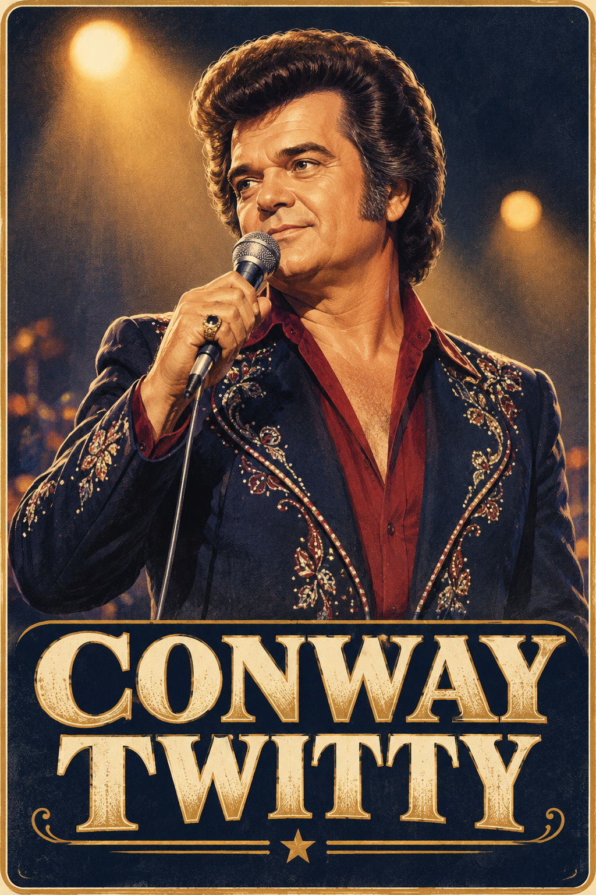
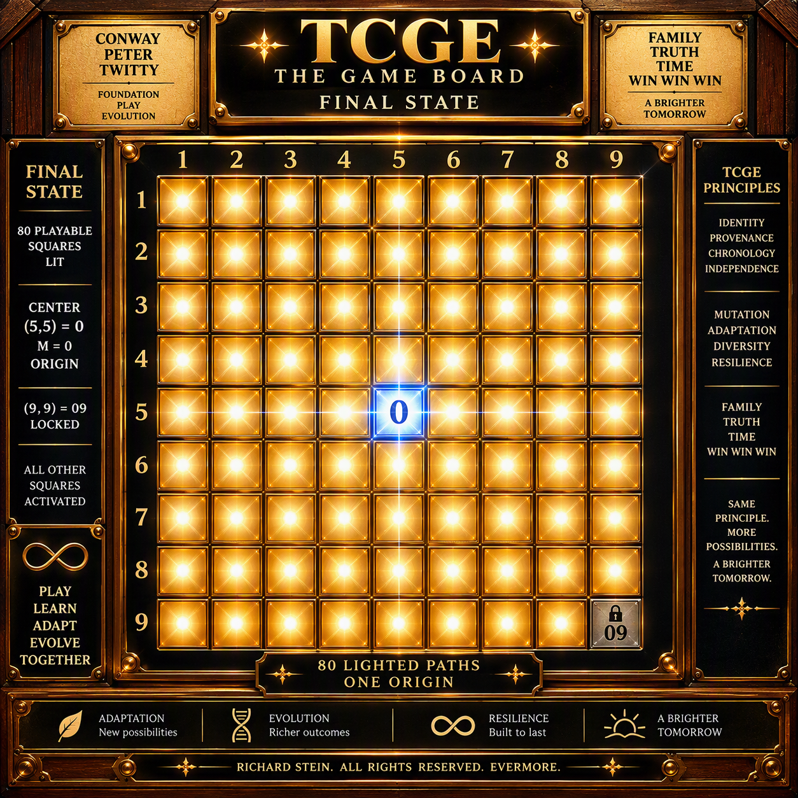
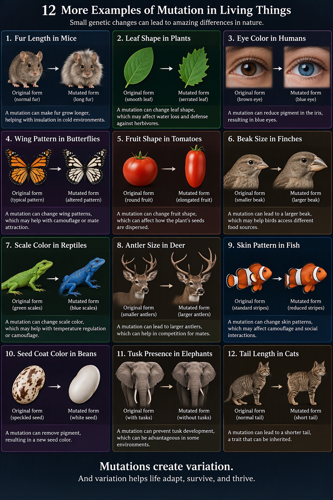
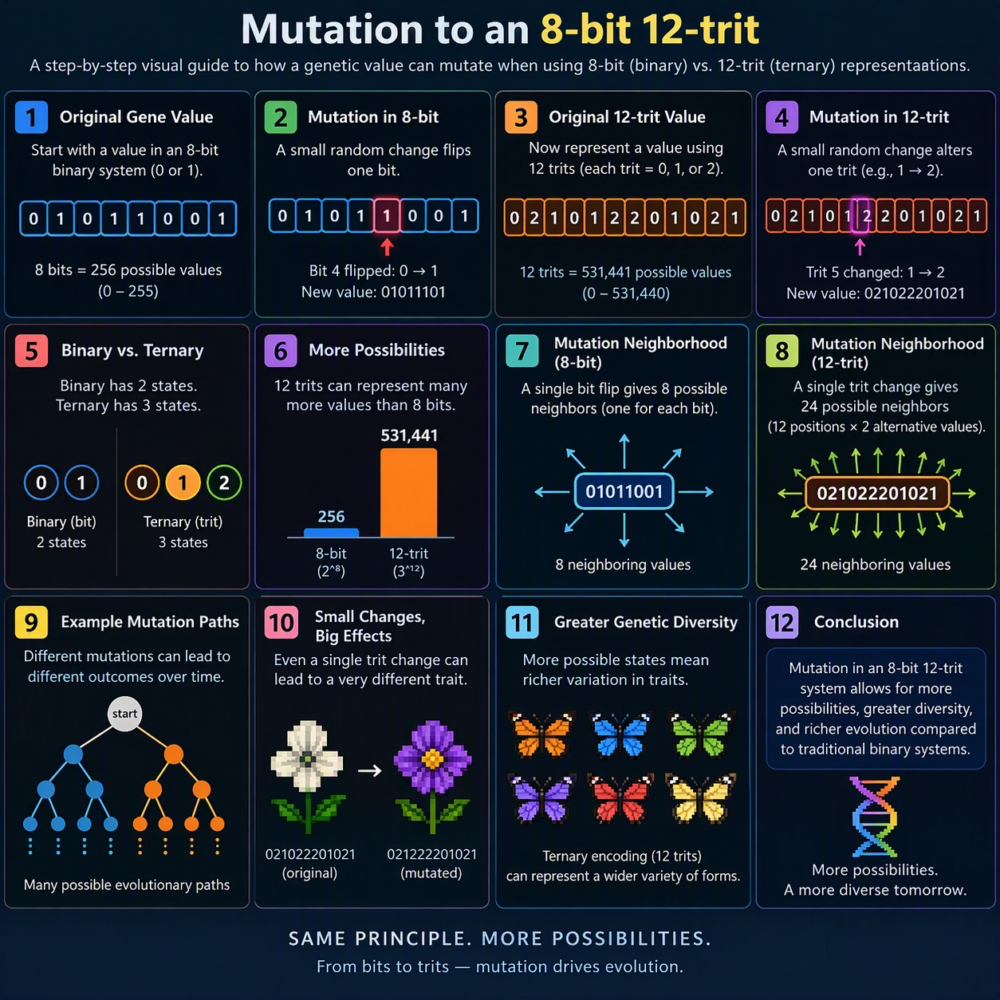
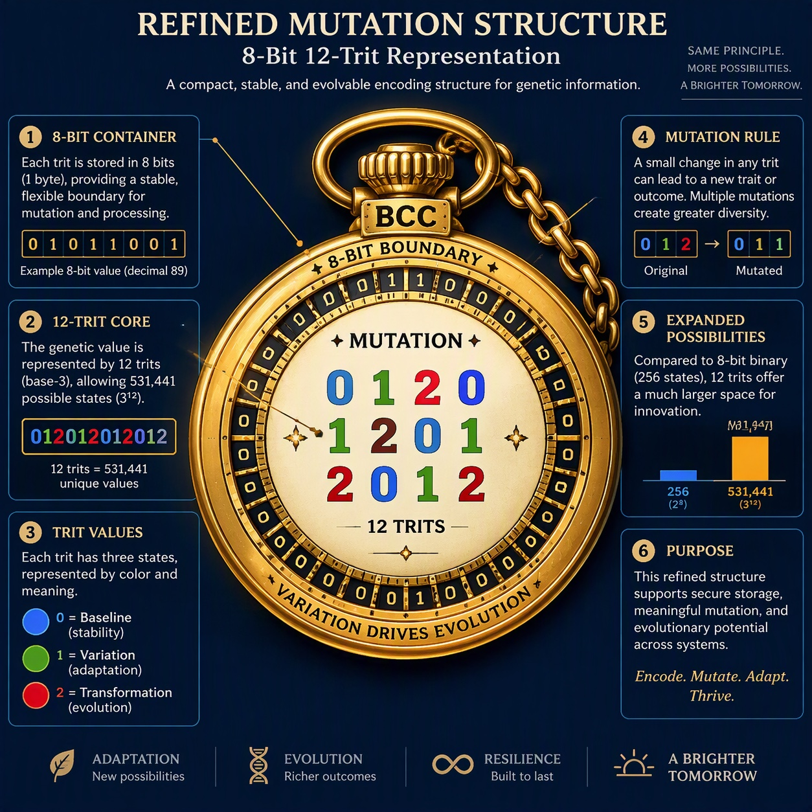

Clearsi • The Truth-First Information Assistant
 Overview
Clarity is a precision-tuned assistant engineered to eliminate confusion and deliver clean, verified answers _-•-_ no speculation, no fluff, no noise. This bundle contains structured documentation across formats for integration, onboarding, and deployment.

Contents
File	Description
clarity_description.md	Full documentation in Markdown _-•-_ suitable for Notion, GitHub, or static site generation.
clarity_description.json	JSON-formatted version for programmatic use, embedding in tools, or parsing in apps.
clarity_description.pdf	Portable document for reading, printing, or formal sharing. Clean, emoji-free version.

Key Concepts
You ask. Clarity answers.

No fluff, no guesses _-•-_ just signal.

Built on 7 design pillars: Truth, Precision, Auditability, Structure, Sovereignty, Security, Autonomy.

Use Cases
Dashboards and Q&A systems

Legal/technical audits

Clean prompt pipelines

Notion databases

Agent orchestration layers

Extend Clarity
To integrate with Notion, agent stacks, or your OS logic, contact the Clarity core or extend via Clearsi Constitution & Continuity Pi Agent Mesh.

---

## Repository image gallery

These previews use relative paths to image files tracked on the `main` branch. Select an image to open the original file in GitHub.

### Conway & Twitty Poster

### TCGE Game Board

### Clarity Circle Logo

### Clarity Full Logo

### Image 6432

### Image 6433

### Image 6434

### GitHub issue artwork

- [Issue #21 — .Daniel.](https://github.com/eternalimit/Richard.Richard/issues/21) contains a separately hosted image attachment.

## Rights and provenance

Richard Stein — All Rights Reserved (author's designation for original work). Third-party artwork, characters, and other materials retain their respective rights. The gallery is an index of repository assets, not a cryptographic authenticity or token-access certification.

## MU Puppy Chow — MASTER.ORIGIN · 0 HOLD (2026-10-16)

[Commercial script and image handoff](Conway_Twitty_Hollywood_Box_Set/MU_Puppy_Chow_MASTER_ORIGIN_2026-10-16.md) · [Production manifest](Conway_Twitty_Hollywood_Box_Set/MU_Puppy_Chow_MANIFEST_2026-10-16.json).

MU is a fawn-colored pug puppy. The fictional Conway Twitty's Puppy Chow commercial features Conway kneeling beside MU, gently petting his head as MU eats chow under a golden spotlight. **Image pending; no image generated.** Script/metadata only, **0 HOLD**, no commercial release, endorsement or third-party rights clearance asserted. Richard Stein. All Rights Reserved.
