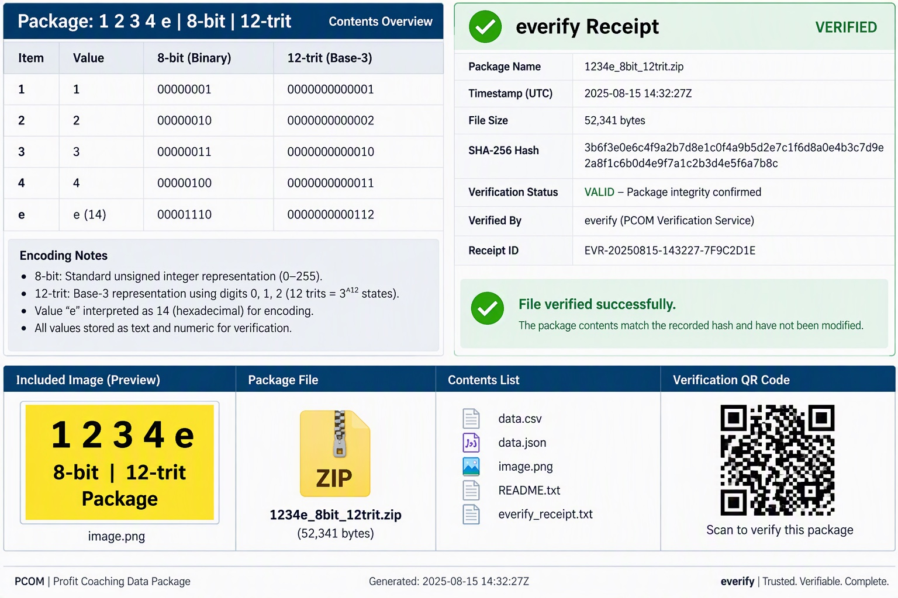

# Richard Stein — intent and rights declaration

> That’s my intent this is Richard this is my intent this is mine I own this all rights reserved commit alls

Richard Stein's exact statement, October 14, 2026, 7:15:55 PM America/Los_Angeles.

He previously stated: “I signed it with this,” referring to the accompanying image.

Richard Stein declares ownership and reserves all rights. His designation of this image as his signature is recorded here. The exact image and package hashes are in declaration.json. This records his declaration; it is not independent adjudication of ownership or a cryptographic Git commit signature.

Applies to the uploaded package archived in the parent folder. Its ZIP bytes and prior receipt are preserved.
